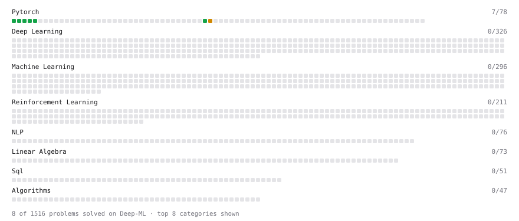

# Deep-ML

My machine learning practice from [Deep-ML](https://www.deep-ml.com). Every solution here was written by hand.

**16** solved · 12 problems · 1 labs · 3 math

[**Browse the interactive portfolio**](https://utsusemioxo.github.io/deep-ml/) to replay this filling in over time.

## Problems

| | Difficulty | Solved | |
| --- | --- | --- | --- |
| [Add a Bias Vector to a Batch via Broadcasting](https://www.deep-ml.com/problems/882) | easy | 2026-10-10 | [solution](problems/0882-add-a-bias-vector-to-a-batch-via-broadcasting) |
| [Compute a Gradient with PyTorch Autograd](https://www.deep-ml.com/problems/884) | easy | 2026-10-10 | [solution](problems/0884-compute-a-gradient-with-pytorch-autograd) |
| [Create a Float Tensor from a Python List](https://www.deep-ml.com/problems/880) | easy | 2026-10-10 | [solution](problems/0880-create-a-float-tensor-from-a-python-list) |
| [Implement a Linear Layer Forward Pass with Matrix Multiplication](https://www.deep-ml.com/problems/883) | easy | 2026-10-10 | [solution](problems/0883-implement-a-linear-layer-forward-pass-with-matrix-multiplication) |
| [Implement ReLU and Leaky ReLU](https://www.deep-ml.com/problems/1226) | easy | 2026-10-11 | [solution](problems/1226-implement-relu-and-leaky-relu) |
| [Mean Squared Error from Scratch](https://www.deep-ml.com/problems/1228) | easy | 2026-10-12 | [solution](problems/1228-mean-squared-error-from-scratch) |
| [Reshape and Transpose a Tensor](https://www.deep-ml.com/problems/881) | easy | 2026-10-10 | [solution](problems/0881-reshape-and-transpose-a-tensor) |
| [Single Linear Neuron Forward](https://www.deep-ml.com/problems/1224) | easy | 2026-10-10 | [solution](problems/1224-single-linear-neuron-forward) |
| [Binary Cross-Entropy from Logits](https://www.deep-ml.com/problems/1229) | medium | 2026-10-27 | [solution](problems/1229-binary-cross-entropy-from-logits) |
| [Derivative of Softmax](https://www.deep-ml.com/problems/219) | medium | 2026-10-09 | [solution](problems/0219-derivative-of-softmax) |
| [Numerically Stable Softmax](https://www.deep-ml.com/problems/1227) | medium | 2026-10-11 | [solution](problems/1227-numerically-stable-softmax) |
| [Two-Layer MLP Forward Pass](https://www.deep-ml.com/problems/1225) | medium | 2026-10-11 | [solution](problems/1225-two-layer-mlp-forward-pass) |

## Labs

| | Difficulty | Solved | |
| --- | --- | --- | --- |
| [Design Your Own Activation Function](https://www.deep-ml.com/labs/9) | easy | 2026-10-10 | [solution](labs/0009-design-your-own-activation-function) |

## Math

| | Difficulty | Solved | |
| --- | --- | --- | --- |
| [Backpropagation and the Chain Rule](https://www.deep-ml.com/math-problems/4) | medium | 2026-10-28 | [solution](math/0004-backpropagation-and-the-chain-rule) |
| [Matrix Calculus Identities](https://www.deep-ml.com/math-problems/35) | medium | 2026-10-28 | [solution](math/0035-matrix-calculus-identities) |
| [Neural Network Derivatives](https://www.deep-ml.com/math-problems/3) | medium | 2026-10-28 | [solution](math/0003-neural-network-derivatives) |

---

_This file is regenerated by Deep-ML on every push._
